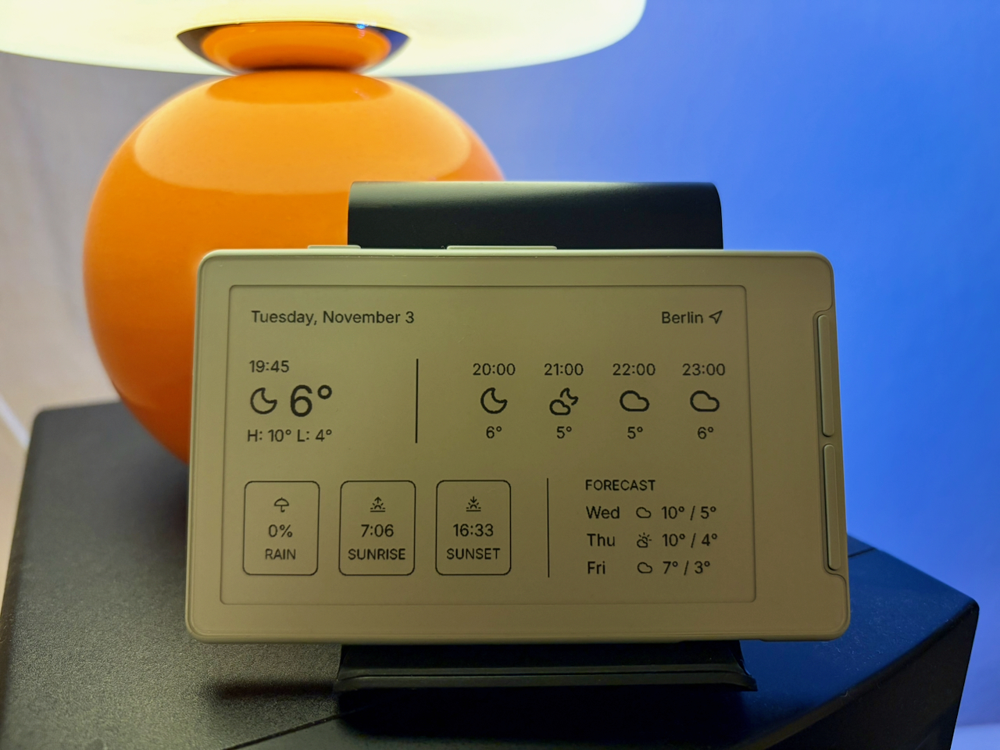

# Weather for CrossPoint

Show current weather conditions and a three-day forecast on your CrossPoint sleep screen.



## Installation

Install the plugin from Plugin Hub, or manually
copy the files listed in
[`weather.crosspoint-plugin/manifest.json`](weather.crosspoint-plugin/manifest.json)
into `/plugins/weather/` on the reader's SD card. Copy the listed files, not
the enclosing folder.

In the CrossPoint web interface, open the Weather settings, search for a city,
select it, and save. Choose the time format and temperature unit, then put the
reader to sleep to download the updated `/sleep.bmp`. Automatic time format
follows the selected city's country.

Make sure the reader is set up to show a sleep image.

**Note:** The plugin replaces
`/sleep.bmp` with its weather image whenever the sleep screen refreshes; back
up your existing image if you may want to restore it later.

## Worker (optional)

The plugin uses a hosted Worker by default. It requests forecasts from
Open-Meteo and generates the sleep-screen BMP.

To run your own Worker, from the repository root:

```sh
cd worker
npm ci
npm run dev
```

Deploy it to your Cloudflare account in a separate terminal:

```sh
cd worker
npx wrangler login
npm run deploy
```

After deployment, change `worker_url` in the plugin's `config.json` on the SD
card to your Worker endpoint ending in `/weather.bmp`. Keep the full path; the
plugin appends the location and display settings to it.

The reader sends the selected city's coordinates to the configured Worker,
which forwards them to Open-Meteo. The Worker does not persist your location
in a database or logs: query strings are redacted from logs, and invocation
logs are not persisted. Cloudflare may temporarily cache the generated image
for up to one hour. Open-Meteo says its troubleshooting logs may include
coordinates and are deleted after 90 days; see its
[privacy terms](https://open-meteo.com/en/terms).

## Attribution

Weather data is provided by [Open-Meteo](https://open-meteo.com/) and its
weather-model providers under [CC BY 4.0](https://creativecommons.org/licenses/by/4.0/).
The bundled Inter font is under the SIL Open Font License (see
[`worker/src/Inter-LICENSE.txt`](worker/src/Inter-LICENSE.txt)); Lucide icons
are under the ISC license.

## TODO

- Add locale-aware date and number formatting; keep interface language English
  for now.
- Explore a vertical dashboard layout.
